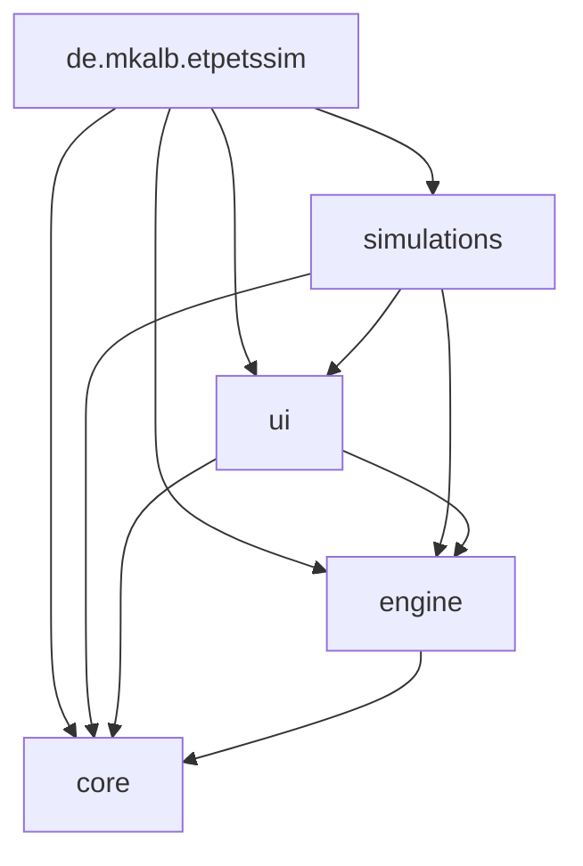
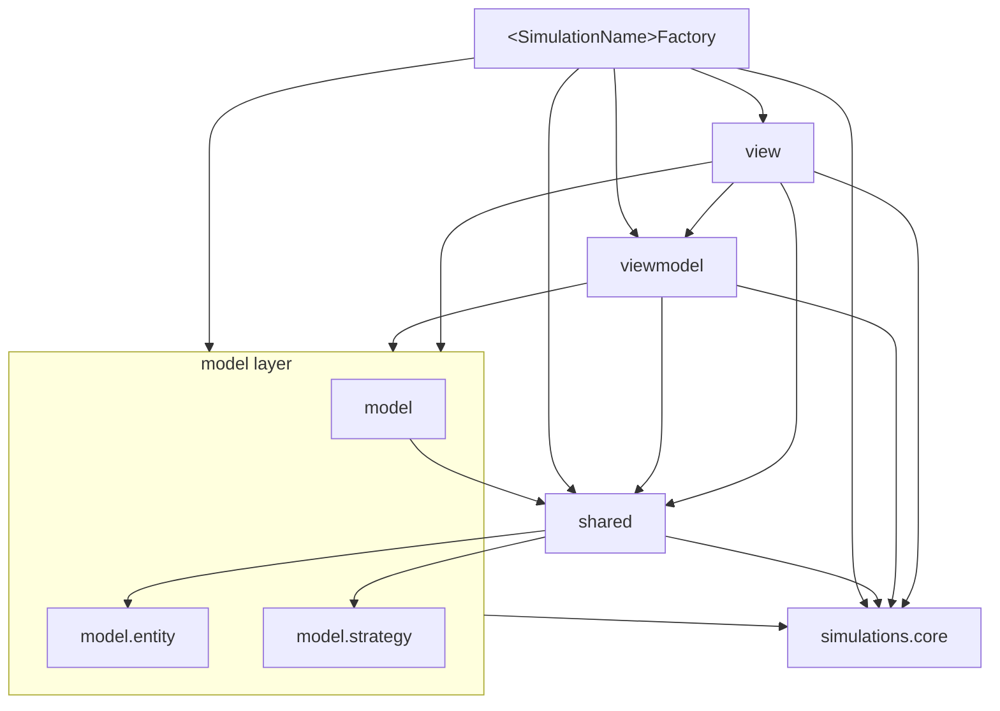

# Architecture

This document gives developers a quick overview of the allowed dependencies between the packages of the application
and between the MVVM layers of a simulation. The rules themselves are the source of truth: "Package Boundaries" in
[`AGENTS.md`](../../AGENTS.md) and "MVVM Dependencies" in
[`.claude/rules/simulations.md`](../../.claude/rules/simulations.md). Update this document when they change.

In both diagrams, an edge `A --> B` means "A may depend on B".

## Package Layers

The root package `de.mkalb.etpetssim` (`EtpetssimLauncher`, `EtpetssimApplication`, `StartScreen`) may depend on all
packages; no package depends on it. `core` holds cross-cutting utilities, `engine` the grid, topology, model,
neighborhood, and execution engine, and `ui` the reusable JavaFX UI infrastructure.

`simulations` contains the shared simulation infrastructure in `simulations.core` and one package per simulation.
Simulations do not depend on each other. The only allowed access from outside a simulation is
`simulations.core.SimulationFactory`, which imports the package-root `<SimulationName>Factory` classes.

## MVVM Structure of a Simulation

Each simulation package has the MVVM layers `model`, `viewmodel`, and `view`, an optional `shared` package for
layer-neutral types, and the package-root `<SimulationName>Factory`, which wires the layers together. `model`,
`model.entity`, and `model.strategy` form one model layer and may depend on each other. `shared` exists because the
model must not depend on `view` or `viewmodel`; it may use `model.entity` and `model.strategy`, but not the `model`
package itself.

The diagram omits the edges inside the model layer and the edges to `core`, `engine`, and `ui`. The table in
"Allowed Dependencies" of [`.claude/rules/simulations.md`](../../.claude/rules/simulations.md) lists them, together
with the `simulations.core` sub-packages each layer may use. No part of a simulation depends on the package root of
`simulations.core`.

Two packages have a special role:

- `simulations.core`: shared simulation infrastructure, organized in the same sub-packages `model`, `shared`,
  `viewmodel`, and `view`.
- `lab`: development showcase with the regular structure, hidden from the start screen
  ([`simulation-lab.md`](simulation-lab.md)).
