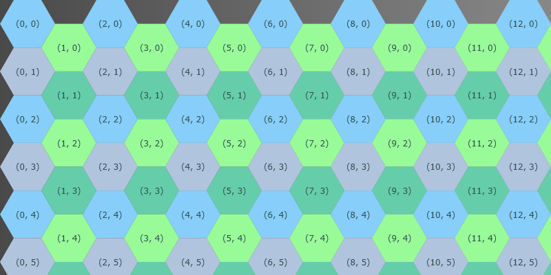
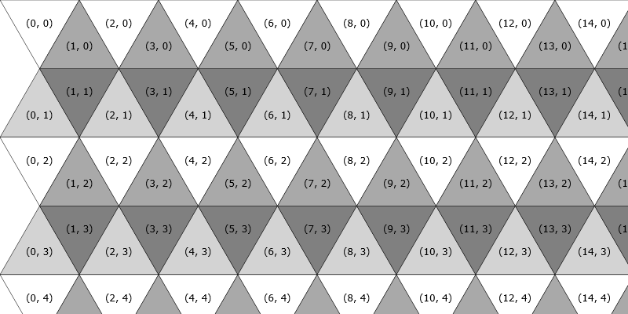
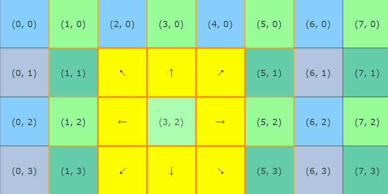

# Simulation Lab

The Simulation Lab (`de.mkalb.etpetssim.simulations.lab`) is a development tool for testing grid rendering, cell
shapes, neighborhoods, and edge behavior. It runs no simulation steps. It is hidden from the start screen and the
README and is started only with a command-line alias:

```powershell
.\gradlew.bat :app:run --args="--simulation=lab"
```

The alias `simulationlab` works as well.

## Configuration

- Structure: cell shape, edge behavior, grid width and height (up to 100 x 100).
- Layout: cell edge length (1 to 1000), cell display mode (shape or circle, each with or without border), and color
  mode (color or grayscale).
- Initialization: seed for the random cells of the model.
- Rules: neighborhood mode.

Each configuration change clears the canvas; press "Draw" to draw the grid again.

## Buttons

- **Draw:** creates the grid and draws a checkerboard of four colors (by column and row parity) with the coordinate
  in each cell.
- **Draw Model:** fills the highlighted cells of the model in translucent red: three random cells (by seed) and a
  small cross at (5,5).
- **Draw Test:** draws a fixed test pattern of the canvas painter primitives at fixed coordinates: cell bounding
  boxes and inner circles with inside and outside strokes, single pixels, a triangle and a hexagon, and cell frame
  segments. A grid of at least about 12 x 11 cells shows the whole pattern.

The colored bars around the canvas come from `lab.css` and make the border regions of the canvas visible.

## Mouse

On hover:

- red outline: the estimated cell (`GridGeometry.estimateGridCoordinate`),
- dark slate blue bounding box and white inner circle with the short name of the entity: the exact cell
  (`GridGeometry.fromCanvasPosition`), the circle only from an edge length of 6,
- green dot: the mouse position.

On click, the observation panel shows the cell, and the canvas shows the neighborhood of the cell for the configured
neighborhood mode and edge behavior. A second click on the same cell clears the selection.

| Highlight                  | Meaning                                                                                                                  |
|----------------------------|--------------------------------------------------------------------------------------------------------------------------|
| Rosy brown outer circle    | Clicked cell                                                                                                             |
| Gold / tomato inner circle | Cells of the radius ring 5 / 3; the stroke width grows with the number of cells of the previous ring that reach the cell |
| Orange outline             | Valid neighbor coordinates within radius 2, without edge behavior                                                        |
| Yellow fill with arrows    | Direct neighbors with edge behavior; the arrows show their directions from the clicked cell                              |
| Dark orange outline        | Edge behavior result `VALID`                                                                                             |
| Dark red outline           | Edge behavior result `WRAPPED`                                                                                           |
| Dark red fill              | Edge behavior result `BLOCKED`                                                                                           |

`ABSORBED` results are not drawn.

## Methods used only by the lab

In main code, these methods are used only by the lab. They are not dead code; remove them only together with the
corresponding lab feature.

- `FXGridCanvasPainter`: `drawCellBoundingBox`, `drawCellFrameSegment`, `drawHexagon`, `drawPixelDirect`,
  `drawPixelRect`, `drawTriangle`
- `GridGeometry.estimateGridCoordinate`
- `CellNeighborhoods.neighborCoordinatesWithinRadius`

## Screenshots




