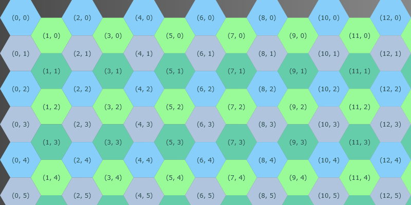
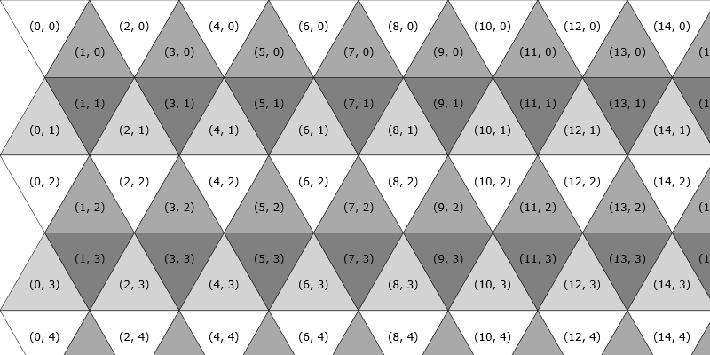
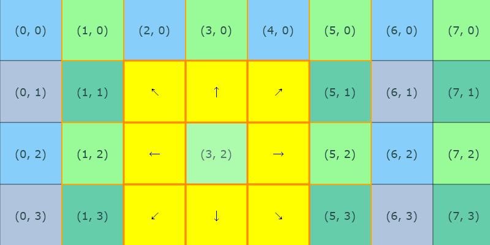

# Simulation Lab

The Simulation Lab (`de.mkalb.etpetssim.simulations.lab`) is a development tool and a visual test bench for grid
rendering, cell shapes, neighborhoods, edge behavior, the grid initializers and patterns of `engine.support`, and the
drawing toolkit of `ui`, including methods that no simulation uses yet. It is built like the other simulations, with
the same `simulations.core` classes, but its steps change no cells. It is hidden from the start screen and the README
and is started only with a command-line alias (PowerShell on Windows; on Linux, use `./gradlew` instead of
`.\gradlew.bat`):

```powershell
.\gradlew.bat :app:run --args="--simulation=lab"
```

The alias `simulationlab` works as well.

## Configuration

- Structure: cell shape, edge behavior, grid width and height (8 to 16 384 each, `GridSize.MAX_SIZE`).
- Layout: cell edge length (1 to 1000), cell display mode (shape or circle, each with or without border; used by the
  checkerboard), color mode (color or grayscale), and base layer (see "Base Layers").
- Initialization: seed, distribution of the highlighted cells (see "Distributions"), the percentage of highlighted
  cells (0 to 100 %, default 10 %), and the pattern (see "Patterns").
- Rules: neighborhood mode.

As in the other simulations, the config controls are disabled while the simulation cannot start. The percentage is
disabled while the distribution is not random, the pattern while the distribution is not "Pattern".

## Distributions

The distribution decides which cells are highlighted at the start (`LabEntity.HIGHLIGHTED` on `NORMAL`):

| Distribution        | `GridInitializers` method | Amount                                               |
|---------------------|---------------------------|------------------------------------------------------|
| Random, exact share | `fillRandomPercent`       | exactly the percentage of all cells, rounded         |
| Random per cell     | `fillWithProbability`     | each cell independently, with the percentage         |
| Random, fixed count | `placeShuffledCount`      | the percentage of all cells, rounded, shuffled cells |
| Grid edge           | `placeBorder`             | the outermost rows and columns                       |
| Pattern             | `placePattern`            | the selected pattern at the center of the grid       |

The same seed gives the same cells. `fillWithProbability`, `placeBorder`, and `placePattern` have no cancellation
check; the lab uses them deliberately without one (`// Rule deviation (simulations.md)` in `LabSimulationManager`), so
that it shows their behavior on large grids before a simulation uses them.

## Patterns

`LabPatterns` builds the patterns with `GridPatterns` and the transformations of `GridPattern` and scales them to the
grid; `minSide` is the smaller of grid width and height.

- Cross: a `horizontalLine` and a `verticalLine` of the odd length `max(3, minSide / 2)`, `shifted` to cross at their
  centers and joined with `combine`.
- Rectangle outline: a `rectangleOutline` of half the grid width and height.
- Nested rectangles: up to four `rectangleOutline`s, the outer one three quarters of the grid width and height, each
  further one 2 cells inside the previous one.
- Rotations: an L of a vertical arm (`max(2, minSide / 8)` cells) and a shorter foot, in four quadrants: unchanged
  (top left), `rotate90` (top right), `rotate180` (bottom right), and `rotate270` (bottom left).
- Mirrors: the same L, unchanged (top left), `flipX` (top right), `flipY` (bottom left), and `flipX` with `flipY`
  (bottom right).

The anchor places a pattern at the center of the grid, rounded down to an even column and row, so that the pattern
keeps the parity it is designed for (see the Javadoc of `GridInitializers.placePattern`); cells outside the grid are
skipped. Offsets, rotations, and mirrors work on coordinates, so the shapes look distorted on triangle and hexagon
grids; the lab shows this and does not correct it.

## Base Layers

The base layer is drawn once at the start, on a black canvas and a grid background (a horizontal gray gradient, white
in grayscale). It does not depend on the distribution or the model.

- Checkerboard: four colors by column and row parity (four grays in grayscale), drawn as shapes or inner circles by
  the cell display mode, with the coordinate in each cell.
- Painter test: cell *i* in row-major order shows the drawing variant *i* modulo 34 on a thin gray cell outline, with
  the number of the variant below its center, so that the test works for every grid size and cell shape. The color
  mode switches the fill, stroke, and accent colors to grays.

| Number  | Variant                                                                                                 |
|---------|---------------------------------------------------------------------------------------------------------|
| 0 – 5   | `drawCellBoundingBox` with `StrokeType` `INSIDE`, `OUTSIDE`, and `CENTERED`, each without and with fill |
| 6 – 11  | `drawCellInnerCircle`, in the same order                                                                |
| 12 – 17 | `drawCellOuterCircle`, in the same order                                                                |
| 18      | `drawScaledCell` with the scale 0.6                                                                     |
| 19      | `drawTriangleMatchingCellWidth`                                                                         |
| 20      | `drawHexagonMatchingCellWidth`                                                                          |
| 21 – 24 | `drawCellFrameSegment` with `CellShapeSide` `TOP`, `BOTTOM`, `LEFT`, and `RIGHT`                        |
| 25      | `drawCenteredTextInCell` with "Aa"                                                                      |
| 26      | `drawCenteredTextAt` with "+" at the top-left quarter point of the cell bounds                          |
| 27      | `drawPolygon`: a diamond in the cell bounds                                                             |
| 28      | `drawPolyline`: a zigzag in the cell bounds                                                             |
| 29      | `drawPixelDirect`: pixels on the diagonal of the cell bounds from the top left                          |
| 30      | `drawPixelRect`: pixels on the diagonal of the cell bounds from the top right                           |
| 31 – 33 | `drawCell` filled with `createHorizontalGradient`, `createVerticalGradient`, and `createRadialGradient` |

The texts and numbers need the cell font, which exists only from a minimum cell size. The painter test is a visual
check that complements `FXGridCanvasPainterTest`.

## Simulation

- Start creates the grid. The dynamic layer fills the highlighted cells in translucent red.
- Steps leave all cells unchanged. The termination condition is always fulfilled, so the simulation pauses after each
  step while the termination check of the control panel is active.
- The step duration starts at its minimum.
- The observation panel shows the number of highlighted and normal cells with their extrema and a chart of the
  highlighted cells.
- In edit mode, the action "Switch Cell" switches the selected cell between normal and highlighted.

The colored bars around the canvas come from `lab.css` and make the border regions of the canvas visible.

## Mouse

On hover, after the start and except during batch runs:

- red outline: the estimated cell (`GridGeometry.estimateGridCoordinate`),
- dark slate blue bounding box and white inner circle with the short name of the entity in red: the exact cell
  (`GridGeometry.fromCanvasPosition`), the circle only from an edge length of 6,
- green dot: the mouse position,
- while a cell is selected, a label above the pointer: the ring distance from the selected cell and the coordinate
  difference (for example, `Ring: 2, dx/dy: [+1, -1]`). The ring distance comes from the radius rings of
  `LabNeighborhoodHighlights` (`findRingRadius`) and follows the neighborhood mode and edge behavior; beyond the
  largest ring (radius 5), it shows `> 5`. The coordinate difference is `GridCoordinate.offsetTo` and is no distance;
  `GridOffset.manhattanLength()` and `euclideanLength()` are not shown, because they are meaningful only for squares.

A click selects a cell as in the other simulations, while the simulation is paused, canceled, or finished. The
observation panel shows the cell, and the canvas shows the neighborhood of the cell for the configured neighborhood
mode and edge behavior. A second click on the same cell keeps the selection; the control buttons clear it.

| Highlight                  | Meaning                                                                                                                  |
|----------------------------|--------------------------------------------------------------------------------------------------------------------------|
| Rosy brown outer circle    | Selected cell                                                                                                            |
| Gold / tomato inner circle | Cells of the radius ring 5 / 3; the stroke width grows with the number of cells of the previous ring that reach the cell |
| Orange outline             | Valid neighbor coordinates within radius 2, without edge behavior                                                        |
| Yellow fill                | Direct neighbor connected by an edge (`CellNeighborWithEdgeBehavior.isEdgeConnection()`)                                 |
| Smaller goldenrod fill     | Direct neighbor connected by a vertex (`isVertexConnection()`); with wrapping on small grids, a cell may show both       |
| Arrows                     | The directions of the direct neighbors from the selected cell                                                            |
| Dark orange outline        | Edge behavior result `VALID`                                                                                             |
| Dark red outline           | Edge behavior result `WRAPPED`                                                                                           |
| Dark red fill              | Edge behavior result `BLOCKED`                                                                                           |

`ABSORBED` results are not drawn.

## Large Grids

The grid size reaches `GridSize.MAX_SIZE` so that the lab exposes the limits of the engine and the drawing toolkit
before a simulation meets them. Expected limits are findings, not bugs:

- Memory: the step runner keeps two grid models of up to about 268 million cells.
- Drawing time: the base layer draws all cells, also those outside the canvas limit of `AbstractMainView`.
- Initialization time: the initializers without a cancellation check cannot be canceled; `rectangleOutline` visits
  all cells of its bounding box.

## Methods Used Only by the Lab

In main code, these methods are used only by the lab. They are not dead code; remove them only together with the
corresponding lab feature.

- `GridStructure.coordinatesStream`
- `GridCoordinate.offsetTo`
- `CellNeighborWithEdgeBehavior.isEdgeConnection` and `isVertexConnection`
- `CellNeighborhoods.neighborCoordinatesWithinRadius`
- `GridInitializers.fillWithProbability` and `placeBorder`
- `GridPatterns.empty`, `combine`, `horizontalLine`, `verticalLine`, and `rectangleOutline`
- `GridPattern.shifted`, `rotate90`, `rotate180`, `rotate270`, `flipX`, and `flipY`
- `GridGeometry.estimateGridCoordinate`
- `FXGridCanvasPainter`: `fillGridBackground`, `drawCellBoundingBox`, `drawScaledCell`,
  `drawTriangleMatchingCellWidth`, `drawHexagonMatchingCellWidth`, `drawCellFrameSegment`, `drawCenteredTextAt`,
  `drawPolygon`, `drawPolyline`, `drawPixelDirect`, `drawPixelRect`, and `drawCircle`
- `FXPaintFactory.createHorizontalGradient`, `createVerticalGradient`, and `createRadialGradient`
- `FXComponentFactory.createHBox`

`GridInitializers.placeWithProbability` and `placeRandomCount` are used by no simulation and not by the lab either.

## Screenshots




