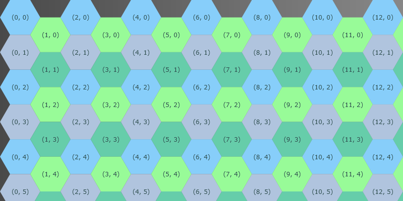
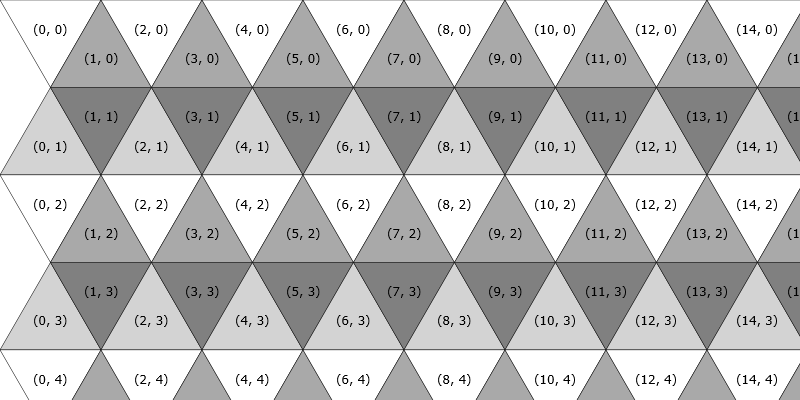
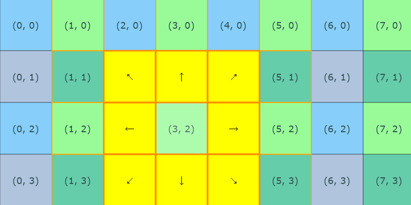

# Simulation Lab

The Simulation Lab (`de.mkalb.etpetssim.simulations.lab`) is a development tool for testing grid rendering, cell
shapes, neighborhoods, and edge behavior. It is built like the other simulations, with the same `simulations.core`
classes, but its steps change no cells. It is hidden from the start screen and the README and is started only with a
command-line alias (PowerShell on Windows; on Linux, use `./gradlew` instead of `.\gradlew.bat`):

```powershell
.\gradlew.bat :app:run --args="--simulation=lab"
```

The alias `simulationlab` works as well.

## Configuration

- Structure: cell shape, edge behavior, grid width and height (up to 100 x 100).
- Layout: cell edge length (1 to 1000), cell display mode (shape or circle, each with or without border), and color
  mode (color or grayscale).
- Initialization: seed and the share of highlighted cells (0 to 100 %, default 10 %).
- Rules: neighborhood mode.

As in the other simulations, the config controls are disabled while the simulation cannot start.

## Simulation

- Start creates the grid. The base layer shows a checkerboard of four colors (by column and row parity) with the
  coordinate in each cell; the dynamic layer fills the highlighted cells in translucent red. The seed determines which
  cells are highlighted.
- Steps leave all cells unchanged. The termination condition is always fulfilled, so the simulation pauses after each
  step while the termination check of the control panel is active.
- The step duration starts at its minimum.
- The observation panel shows the number of highlighted and normal cells with their extrema and a chart of the
  highlighted cells.
- In edit mode, the action "Switch Cell" switches the selected cell between normal and highlighted.

The colored bars around the canvas come from `lab.css` and make the border regions of the canvas visible.

## Mouse

On hover, after the start and except during batch runs:

- red outline: the estimated cell (`GridGeometry.estimateGridCoordinate`),
- dark slate blue bounding box and white inner circle with the short name of the entity in red: the exact cell
  (`GridGeometry.fromCanvasPosition`), the circle only from an edge length of 6,
- green dot: the mouse position.

A click selects a cell as in the other simulations, while the simulation is paused, canceled, or finished. The
observation panel shows the cell, and the canvas shows the neighborhood of the cell for the configured neighborhood
mode and edge behavior. A second click on the same cell keeps the selection; the control buttons clear it.

| Highlight                  | Meaning                                                                                                                  |
|----------------------------|--------------------------------------------------------------------------------------------------------------------------|
| Rosy brown outer circle    | Selected cell                                                                                                            |
| Gold / tomato inner circle | Cells of the radius ring 5 / 3; the stroke width grows with the number of cells of the previous ring that reach the cell |
| Orange outline             | Valid neighbor coordinates within radius 2, without edge behavior                                                        |
| Yellow fill with arrows    | Direct neighbors with edge behavior; the arrows show their directions from the selected cell                             |
| Dark orange outline        | Edge behavior result `VALID`                                                                                             |
| Dark red outline           | Edge behavior result `WRAPPED`                                                                                           |
| Dark red fill              | Edge behavior result `BLOCKED`                                                                                           |

`ABSORBED` results are not drawn.

## Methods used only by the lab

In main code, these methods are used only by the lab. They are not dead code; remove them only together with the
corresponding lab feature.

- `FXGridCanvasPainter.drawCellBoundingBox`
- `GridGeometry.estimateGridCoordinate`
- `CellNeighborhoods.neighborCoordinatesWithinRadius`

## Screenshots




