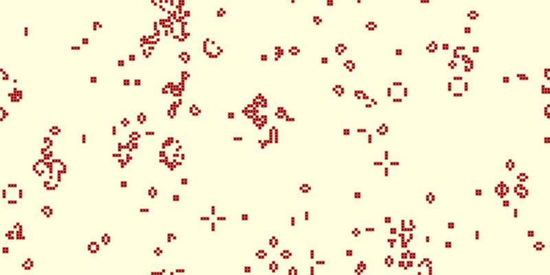

# Conway's Game of Life

Watch cells live and die by simple rules

## Overview

Conway's Game of Life is a grid of cells that are either alive or dead. In every step, each cell looks at how many of
its neighbors are alive and, following a survival and birth rule, stays alive, dies, or comes to life. From these
simple local rules, the grid shows stable shapes, blinking oscillators, moving gliders, and long chaotic phases until
the population settles down or dies out.

## Category and grid

- **Category:** Cellular automata
- **Cell shapes:** Square (default), Triangle, Hexagon
- **Edge behavior:** Wrap X and Y (default), Block X and Y
- **Neighborhood:** Edges and vertices (fixed)

## Rules and mechanics

- At the start, randomly chosen cells are alive according to the share of living cells; all other cells are dead.
- In every step, all cells are updated at the same time from the state of the previous step.
- The neighbors of a cell are all cells that share an edge or a corner with it; hexagon cells have only edge
  neighbors. With wrapping edges, the grid continues on the opposite side; with blocked edges, cells beyond the edge
  do not count.
- A living cell survives if its number of living neighbors is one of the survival counts of the transition rule;
  otherwise it dies.
- A dead cell comes to life if its number of living neighbors is one of the birth counts of the transition rule;
  otherwise it stays dead.
- The run ends on its own when no cell is alive anymore or when a step changes no cell.

## Entities

- **Dead:** a cell without life; it forms the light yellow background of the grid.
- **Alive:** a living cell, drawn in dark red. Depending on the **Cell display** setting, it fills the whole cell or
  an inner circle, either plain or with a light red border.

## Interactive editing

- **Clear grid:** applies globally and makes all cells dead.
- **Toggle cell:** switches the selected cell between dead and alive.
- **Place pattern:** places the pattern chosen in the **Pattern** option at the selected cell, which becomes the
  top-left corner of the pattern. The pattern includes a border of dead cells and overwrites the cells it covers; it
  is placed only if it fits completely inside the grid.

The **Pattern** option offers classic still lifes, oscillators, methuselahs, a replicator, spaceships, and a glider
gun. Patterns are available only for square cells and only for the rules they are made for: the replicator for the
HighLife rule 23/36, all other patterns for Conway's rule 23/3. For other cell shapes or rules, the list is empty.

## Configuration

You can adjust the grid, the display, the starting population, and the transition rule.

### Structure

**Cell shape** and **Grid edge behavior** offer the choices listed under "Category and grid". **Grid width** (8 to
1,000 cells in steps of 2, default 200) and **Grid height** (8 to 1,000 cells in steps of 2, default 100) set the
size of the grid.

### Layout

**Cell edge length** (1 to 50 pixels, default 4) sets the size of each cell on the screen. **Cell display**
(Bordered shape (default), Shape, Inner circle, Bordered inner circle) sets how the cells are drawn.

### Initialization

**Seed** (empty by default) sets the start value of the random numbers: leave it empty for a random seed, or enter a
number or any text to repeat a run.

**Living cells** (0% to 100%, default 30%) sets the share of cells that are alive at the start.

### Rules

Depending on the cell shape, one preset list is shown: the **Triangle**, **Square**, or **Hexagon** preset list. Each
offers well-known rules for its cell shape; no preset is selected by default. Selecting a preset fills in the
transition rule.

**Rule input** (empty by default) takes a rule in S/B notation, with single-digit survival counts, a slash, and
single-digit birth counts (e.g. 23/3), or in B/S notation (e.g. B3/S23). A valid entry updates the checkboxes of the
transition rule; invalid input, including counts that the cell shape does not allow, leaves them unchanged.

**Transition rule** (default 23/3) is a grid of checkboxes with a Survival row and a Birth row for 0 to 9 living
neighbors. Counts above the number of neighbors of the cell shape are disabled (above 8 for square cells and above 6
for hexagon cells), and birth with 0 neighbors is not possible. Triangle cells have up to 12 neighbors, but because
the S/B notation uses single digits, their rule is limited to 9.

## Screenshot

## References

- https://en.wikipedia.org/wiki/Conway%27s_Game_of_Life
