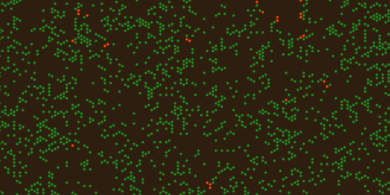

# Forest-fire model

Watch trees grow and lightning spark forest fires

## Overview

The Forest-fire model shows a forest in which trees grow on empty ground, catch fire, and burn down. Lightning
occasionally sets a single tree on fire, and the fire then spreads from tree to tree through neighboring cells. On the
grid, you see green forest areas grow back slowly while fire fronts sweep through them and leave empty ground behind.

## Category and grid

- **Category:** Cellular automata
- **Cell shapes:** Hexagon (default), Triangle, Square
- **Edge behavior:** Block X and Y (default), Wrap X and Y
- **Neighborhood:** Edges only (default), Edges and vertices

## Rules and mechanics

- At the start, trees are placed on randomly chosen cells according to the tree density; all other cells are empty.
- In each step, all cells change at the same time, based on the state of the grid before the step.
- An empty cell grows a new tree with the tree growth chance.
- A tree catches fire if at least one of its neighbors is burning; the neighborhood setting decides which cells count
  as neighbors.
- A tree without a burning neighbor can still be struck by lightning and catch fire with the lightning chance.
- A burning tree burns down in one step and leaves an empty cell.
- With wrapping edges, fire spreads across the grid edge to the opposite side; with blocking edges, it stops at the
  edge.
- The run ends on its own when the grid contains neither trees nor burning trees.

## Entities

- **Empty:** ground without a tree, where a new tree can grow; shown as the very dark brown background of the grid.
- **Tree:** a living tree that can catch fire; shown in sea green, or as the 🌲 emoji in the **Emoji** display mode.
- **Burning:** a tree on fire that sets its neighboring trees on fire and is gone after one step; shown in orange-red,
  with an orange border in the bordered display modes, or as the 🔥 emoji in the **Emoji** display mode.

Depending on the **Cell display** setting, trees and burning trees fill the whole cell shape or are drawn as an inner
circle, with or without a border, or as an emoji.

## Interactive editing

- **Cycle state:** switches the selected cell to its next state, from Empty to Tree, from Tree to Burning, and from
  Burning back to Empty.

## Configuration

You can adjust the grid, how the cells are displayed, the initial share of trees, and the chances of tree growth and
lightning.

### Structure

**Cell shape** and **Grid edge behavior** offer the choices listed under "Category and grid". **Grid width** (8 to
1,000 cells in steps of 2, default 100) and **Grid height** (8 to 1,000 cells in steps of 2, default 50) set the size
of the grid.

### Layout

**Cell edge length** (1 to 50 pixels, default 4) sets the size of each cell on the screen. **Cell display**
(Bordered inner circle (default), Shape, Bordered shape, Inner circle, Emoji) sets how the cells are drawn.

### Initialization

**Seed** (empty by default) sets the start value of the random numbers: leave it empty for a random seed, or enter a
number or any text to repeat a run.

**Tree density** (0% to 100%, default 20%) sets the share of cells that start with a tree.

### Rules

**Neighborhood mode** (Edges only (default), Edges and vertices) decides which cells count as neighbors when fire
spreads. **Tree growth** (0% to 20%, default 0.2%) is the chance that a new tree grows on an empty cell in a step.
**Lightning chance** (0% to 2%, default 0.10%) is the chance that lightning sets a tree on fire in a step.

## Screenshot

## References

- https://en.wikipedia.org/wiki/Forest-fire_model
