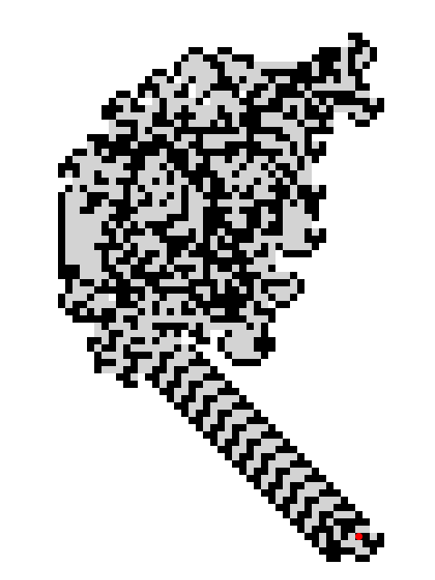

# Langton's ant

Watch an ant turn simple rules into a highway

## Overview

Langton's ant models one or more ants that walk across a grid and recolor every cell they enter. Each ant turns
according to the color of the cell it steps on and then advances that cell to the next color of a configurable turn
rule. Complex patterns grow from these simple rules; with the default rule, the ant eventually builds a regular
"highway" that leads away from its start.

## Category and grid

- **Category:** Agent- and movement-based models
- **Cell shapes:** Square (default), Triangle, Hexagon
- **Edge behavior:** Wrap X and Y (default), Absorb X and Y
- **Neighborhood:** Edges only (fixed)

Langton's ant is a borderline case: it is often described as a cellular automaton (a Turing machine on a grid), but it
is listed here with the movement-based models because its ants move across the grid.

## Rules and mechanics

- The run starts with a single ant in the middle of the grid, facing north, on a black cell; all other cells are
  unvisited.
- In each step, the ants move one after another, row by row from top to bottom and from left to right within a row.
- An ant moves one cell forward in its current direction. With wrapping edges, it reappears on the opposite side of
  the grid; with absorbing edges, an ant that would leave the grid is removed.
- If the target cell is already occupied by another ant, the moving ant is removed.
- On the cell it enters, the ant turns as the turn rule specifies for that cell's color; an unvisited cell counts as
  the first color of the rule. One turn step is 90 degrees on square cells and 60 degrees on hexagon and triangle
  cells.
- The ant then advances the cell to the next color of the rule; after the last color, the cell returns to the first
  one. The rule has one color per turn.
- The run ends on its own when no ant is left or when every cell of the grid has been visited.

## Entities

- **Ant:** an ant that walks across the grid, turns on each cell it enters, and recolors it; drawn as a red inner
  circle with a black border and a black arrow that points in its current direction.
- **Unvisited terrain:** a cell that no ant has entered yet; drawn as the white background of the grid.
- **Terrain 0** to **Terrain 15:** visited cells, numbered by their position in the turn rule; only as many colors
  appear as the rule has turns. With **Shape**, they fill the whole cell; with **Bordered shape**, the cell also has a
  white border. Their colors in order are light gray, black, orange, yellow, green, dark green, blue, dark blue,
  purple, violet, pink, brown, cyan, magenta, deep pink, and gold.

An ant and a terrain color can share a cell; the ant is drawn on top of the terrain.

## Interactive editing

- **Remove ant:** removes the ant from the selected cell, if there is one.
- **Add ant:** adds an ant to the selected cell, only if the cell is unvisited and holds no ant. The cell becomes
  black, like the start cell of the first ant. Its **Direction** option sets the direction of the new ant: North,
  East, South, and West for square cells, and North, Northeast, Southeast, South, Southwest, and Northwest for hexagon
  cells. For triangle cells, the option is hidden and the direction follows from the selected cell: north for a cell
  pointing down and south for a cell pointing up.

## Configuration

You can adjust the grid, its appearance, and the turn rule that drives the ants.

### Structure

**Cell shape** and **Grid edge behavior** offer the choices listed under "Category and grid". **Grid width** (100 to
2,000 cells in steps of 2, default 200) and **Grid height** (100 to 2,000 cells in steps of 2, default 200) set the
size of the grid.

### Layout

**Cell edge length** (1 to 50 pixels, default 4) sets the size of each cell on the screen. **Cell display** (Shape
(default), Bordered shape) sets how the cells are drawn.

### Rules

One preset list is shown for each cell shape, labeled **Triangle**, **Square**, or **Hexagon**; only the list for the
selected cell shape is visible, and each offers well-known turn rules that suit that shape. No preset is selected by
default. Selecting a preset fills in the turn rule.

**Turn rule** (default RL) sets one turn per terrain color with L (left), R (right), L2 (left twice), R2 (right twice),
N (no turn), and U (U-turn), with 2 to 16 turns in total; triangle cells allow only L, R, and U. An empty rule or one
that is invalid for the selected cell shape shows a validation message.

## Screenshot

## References

- https://en.wikipedia.org/wiki/Langton%27s_ant
