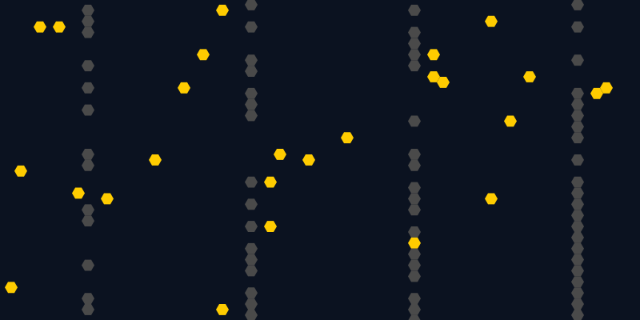

# Rebounding entities

Watch rebounders bounce off and break walls

## Overview

Rebounders move in straight lines across a bounded grid. They bounce off the grid edges and off walls, and every
wall they bounce off breaks. When a rebounder runs into another one, it knocks it out and takes its place, so the
number of rebounders shrinks over time until at most one is left.

## Category and grid

- **Category:** Agent- and movement-based models
- **Cell shapes:** Hexagon (default), Square
- **Edge behavior:** Block X and Y (fixed)
- **Neighborhood:** Edges and vertices (default), Edges only

## Rules and mechanics

- At the start, the vertical walls are placed as full-height columns, evenly spaced and centered across the grid. No
  walls are placed if the grid is narrower than the number of walls or if walls and rebounders together would not
  fit on the grid.
- The rebounders are then placed on random free cells, each with a random direction from the directions that the
  cell shape and neighborhood mode offer.
- In each step, the rebounders act one after another, row by row from the top left. Each one looks at the
  neighboring cell in its direction and moves there if the cell is free ground.
- If that cell is a wall, the rebounder bounces off it and stays in place, and the wall breaks and turns into ground.
- At the grid edge, the rebounder bounces and stays in place as well. A rebounder moving straight north, east, south,
  or west reverses its direction; a diagonal one is mirrored at the edge, like a ball off a cushion. At walls and in
  the grid corners, a diagonal rebounder reverses its direction.
- If that cell holds another rebounder, the moving rebounder knocks it out and takes its cell without changing its
  direction. A rebounder that was knocked out earlier in the step no longer moves.
- The run ends on its own when at most one rebounder is left.

## Entities

- **Ground:** the free space in which the rebounders move; it is drawn as the dark navy blue background of the grid.
- **Wall:** an obstacle that breaks as soon as a rebounder bounces off it; it fills its cell in dark gray.
- **Rebounder:** a moving entity that keeps its direction until it bounces and knocks out other rebounders in its
  way; it fills its cell in golden yellow.

With **Cell display** set to **Bordered shape**, walls and rebounders get a thin border in the background color; with
**Shape**, they fill their cells without a border.

## Interactive editing

- **Add wall:** places a wall on the selected cell, but only on a free ground cell.
- **Remove wall:** turns the selected cell back into ground, but only if it holds a wall.
- **Remove rebounder:** removes the rebounder from the selected cell, but only if it holds a rebounder.
- **Fill with walls:** applies globally and turns every free ground cell into a wall.
- **Add rebounder:** places a new rebounder on the selected cell, but only on a free ground cell. Its **Direction**
  option sets the direction of the new rebounder: North, Northeast, East, Southeast, South, Southwest, West, and
  Northwest for square cells with the neighborhood mode Edges and vertices; North, East, South, and West for square
  cells with Edges only; and North, Northeast, Southeast, South, Southwest, and Northwest for hexagon cells.

## Configuration

You can adjust the grid, its display, the initial walls and rebounders, and the directions in which the rebounders
move.

### Structure

**Cell shape** offers the choices listed under "Category and grid". **Grid width** (8 to 1,000 cells in steps of 2,
default 70) and **Grid height** (8 to 1,000 cells in steps of 2, default 30) set the size of the grid.

### Layout

**Cell edge length** (1 to 50 pixels, default 8) sets the size of each cell on the screen. **Cell display** (Shape
(default), Bordered shape) sets how the cells are drawn.

### Initialization

**Seed** (empty by default) sets the start value of the random numbers: leave it empty for a random seed, or enter a
number or any text to repeat a run.

**Vertical walls** (0 to 100 walls, default 2) sets the number of wall columns placed at the start. **Rebounders**
(0% to 10%, default 2%) sets the initial share of all cells that hold a rebounder.

### Rules

**Neighborhood mode** (Edges and vertices (default), Edges only) sets the directions in which rebounders can move:
for square cells, Edges only limits them to the four straight directions, while hexagon cells offer the same six
directions in both modes.

## Screenshot

