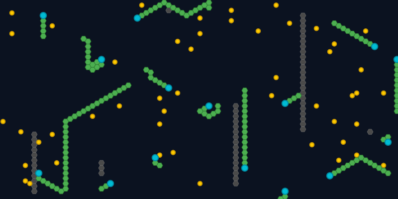

# Snake

Watch snakes hunt for food and grow longer

## Overview

Snake lets many computer-controlled snakes roam a grid at the same time. Each snake follows its own movement strategy,
eats food to grow longer and earn points, and dies when it runs out of free cells to move into. On the grid, you see
green snake bodies led by cyan heads winding between gray walls and yellow food.

## Category and grid

- **Category:** Agent- and movement-based models
- **Cell shapes:** Hexagon (default), Square
- **Edge behavior:** Wrap X, block Y (default); Block X and Y; Wrap X and Y; Block X, wrap Y
- **Neighborhood:** Edges only (fixed)

## Rules and mechanics

- At the start, vertical walls are spread evenly across the grid width, each starting at a random row with a random
  length that leaves a gap; if the grid is too narrow or too low for them, no walls are created.
- The snakes then start as bare heads on random free cells, each with one of the predefined movement strategies
  assigned in turn, and food is placed on random free cells.
- In each step, the snakes act one after another in the order in which they were created; a snake can move only to a
  neighboring ground or food cell within the grid, while walls and the bodies and heads of all snakes block it.
- A snake's strategy rates the possible moves: depending on the strategy, it favors ground or food, keeping its
  direction or making only a small turn, vertical or horizontal moves, and cells next to or away from its own body;
  among equally rated moves it chooses at random.
- When a snake moves, its former head cell becomes a body segment and the last segment is freed, unless the snake
  still has growth left, in which case it becomes one segment longer.
- Eating food gives the snake more growth and points, with a bonus that rises with the snake's length; the eaten food
  reappears on a random free cell.
- A snake with no free neighboring cell dies and stays on the grid until its next turn; it is then removed. With
  respawn, it starts again as a bare head on a random free cell with the same strategy; with permadeath, it disappears
  for good.
- The run ends on its own when no living snake is left.

## Entities

- **Ground:** the free cells that snakes can move across; drawn as the very dark navy blue background of the grid.
- **Wall:** an obstacle that no snake can enter; a dark gray cell with a lighter gray border.
- **Food:** makes a snake grow and earn points when eaten; a yellow inner circle with a darker golden border.
- **Segment:** a body part of a snake that blocks all snakes; a green cell with a darker green border. A dead snake's
  segments turn dull brownish orange until the snake is removed.
- **Head:** the moving front of a snake; a cyan inner circle with a darker cyan border. A dead snake's head turns dull
  dark red until the snake is removed.

## Interactive editing

- **Add wall:** places a wall on the selected cell; only on ground cells.
- **Remove wall:** turns the selected wall back into ground.
- **Add food:** places food on the selected cell; only on ground cells.
- **Remove food:** turns the selected food back into ground.
- **Remove snake:** removes the whole snake, living or dead, whose head or segment is on the selected cell.
- **Add snake:** places a new snake as a bare head on the selected cell, only on ground cells; it starts with the
  configured initial growth. The **Strategy** option offers all predefined movement strategies, each a combination of
  the preferences described under "Rules and mechanics".

## Configuration

You can adjust the grid, the cell size, the starting walls, food, and snakes, and how snakes grow, score, and die.

### Structure

**Cell shape** and **Grid edge behavior** offer the choices listed under "Category and grid". **Grid width** (8 to
1,000 cells in steps of 2, default 80) and **Grid height** (8 to 1,000 cells, default 40) set the size of the grid.

### Layout

**Cell edge length** (1 to 50 pixels, default 6) sets the size of each cell on the screen.

### Initialization

**Seed** (empty by default) sets the start value of the random numbers: leave it empty for a random seed, or enter a
number or any text to repeat a run.

**Vertical walls** (0 to 100 walls, default 6) and **Food cells** (0 to 10,000 cells, default 50) set how many walls and
food cells are placed at the start.

**Snakes** (0 to 1,000 snakes, default 15) sets how many snakes are placed at the start. **Initial growth** (0 to 1,000
segments, default 2) sets how many segments a new or respawned snake grows after it starts.

### Rules

**Death mode** (Respawn (default), Permadeath) sets whether a dead snake starts again or disappears.

**Growth per food** (0 to 100 segments, default 1) sets how much longer a snake grows from each food.
**Base points per food** (0 to 100, default 10) and **Bonus per segment** (0.0 to 5.0, default 0.5) set the points for
each food: the base points plus the bonus for every segment of the snake.

## Screenshot

## References

- https://en.wikipedia.org/wiki/Snake_(video_game_genre)
