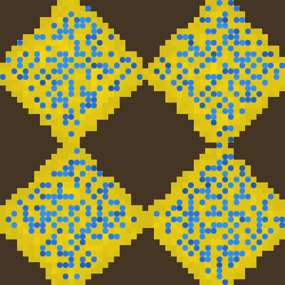

# Sugarscape

Watch agents gather sugar to survive

## Overview

Sugarscape models a population of agents that live on a landscape of sugar. Sugar is piled up in hills around a few
peaks and grows back over time, while the agents search their surroundings for the richest sugar, eat it, and burn
energy with every step. You see the agents move toward and gather around the sugar hills, the hills fade where they
are grazed and brighten again as the sugar grows back, and new agents appear where others have died.

## Category and grid

- **Category:** Agent- and movement-based models
- **Cell shapes:** Square (default), Hexagon
- **Edge behavior:** Wrap X and Y (default); Block X and Y; Block X, wrap Y; Wrap X, block Y
- **Neighborhood:** Edges only (fixed)

## Rules and mechanics

- At the start, sugar hills form around peaks at fixed positions: in the center and at the quarter points of the
  grid. The sugar is highest at each peak, decreases with some randomness toward the edge of the peak radius, and
  the cells outside all hills remain bare terrain. Each sugar cell can later grow back only up to its starting
  amount.
- Agents are placed on random cells, each with the same starting energy.
- In each step, the agents act one after another in a random order.
- An agent looks in each neighbor direction as far as its vision reaches, but it sees past a direct neighbor only if
  that neighbor is free. It picks the free cell with the most sugar, prefers a closer cell among equal ones, and
  stays where it is if its own cell is just as rich. It then moves one cell toward that target.
- The agent eats all sugar of the cell it stands on, which adds to its energy, and then uses up energy for its
  metabolism.
- An agent dies when it reaches its maximum age or runs out of energy.
- After all agents have acted, a new agent with the starting energy appears on a random free cell for every agent
  that died, so the population stays constant.
- At the end of each step, the sugar on every sugar cell grows back by the regeneration amount, up to the capacity
  of that cell.
- The run ends on its own only when no agent is left, for example when it starts without agents.

## Entities

- **Terrain:** bare ground without sugar; it is shown as the dark brown background of the grid.
- **Sugar:** a cell with sugar that agents can eat and that grows back over time; it fills the whole cell in golden
  yellow and becomes brighter the more sugar it holds.
- **Agent:** a gatherer that moves toward sugar and needs it to survive; it is drawn as a blue circle inside the cell
  that becomes brighter with more energy. An agent that appeared as a replacement for a dead agent has a white border
  in the following step.

An agent can stand on a sugar cell or on bare terrain; it is drawn on top of the sugar.

## Interactive editing

- **Remove sugar:** removes the sugar from the selected cell and turns it into bare terrain; nothing happens on a
  cell without sugar. An agent on the cell stays.
- **Add sugar:** puts sugar on the selected cell, also on bare terrain, and replaces any sugar there. The cell can
  then hold up to the configured **Sugar capacity**. The **Sugar level** option sets how full the cell starts:
  Low (a quarter of the capacity), Medium (half of it), or High (full).

## Configuration

You can adjust the grid, the cell size, the starting sugar landscape and agents, and the rules for sugar regrowth
and the life of the agents.

### Structure

**Cell shape** and **Grid edge behavior** offer the choices listed under "Category and grid". **Grid width** (10 to
500 cells in steps of 2, default 50) and **Grid height** (10 to 500 cells in steps of 2, default 50) set the size of
the grid.

### Layout

**Cell edge length** (1 to 50 pixels, default 8) sets the size of each cell on the screen.

### Initialization

**Seed** (empty by default) sets the start value of the random numbers: leave it empty for a random seed, or enter a
number or any text to repeat a run.

**Agents** (0% to 100%, default 20%) sets the share of cells that start with an agent. **Agent initial energy** (1 to
20, default 12) sets the energy of every new agent, both at the start and as a replacement.

**Sugar peaks** (1 to 5, default 4) sets the number of sugar hills. **Sugar peak radius** (0 to 100 cells, default 14)
sets how far the sugar of each peak spreads. **Sugar capacity** (1 to 20, default 8) sets the most sugar a cell can
hold, which is the amount at each peak.

### Rules

**Sugar regeneration** (1 to 10, default 1) sets how much sugar grows back on each sugar cell per step.

**Agent metabolism** (1 to 10, default 2) sets how much energy an agent uses per step. **Agent vision** (1 to 10 cells,
default 8) sets how far an agent can see in each direction. **Agent max age** (1 to 1,000 steps, default 100) sets the
age at which an agent dies.

## Screenshot

## References

- https://en.wikipedia.org/wiki/Sugarscape
