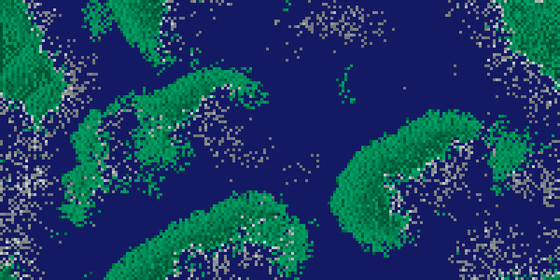

# Wa-Tor

Watch sharks hunt fish in the ocean

## Overview

Wa-Tor is a predator-prey simulation in an ocean. Fish swim around at random and multiply, while sharks hunt the fish
to gain energy and starve when they find none. On the grid, you see swarms of fish spread through the water, sharks
follow and thin them out, and both populations rise and fall in waves.

## Category and grid

- **Category:** Agent- and movement-based models
- **Cell shapes:** Square (default), Triangle, Hexagon
- **Edge behavior:** Wrap X and Y (default), Block X and Y
- **Neighborhood:** Edges only (default), Edges and vertices

## Rules and mechanics

- At the start, the whole grid is water; fish and sharks are placed on random cells in the configured shares. Each
  creature starts with a random age up to its maximum age, and each shark starts with the birth energy.
- In every step, all fish and sharks act one after another, row by row from the top left. A creature only looks at
  its neighboring cells; at blocked edges, there are no neighbors beyond the edge.
- A fish swims to a random neighboring water cell; if there is none, it stays where it is.
- After swimming, a fish that is old enough and has waited long enough since its last offspring leaves a new fish in
  the cell it came from. A fish dies when it reaches its maximum age.
- A shark loses energy every step. If a fish is next to it, it moves into the cell of a random neighboring fish, eats
  it, and gains energy; otherwise it swims to a random neighboring water cell, if there is one.
- After moving, a shark that is old enough, has enough energy, and has waited long enough since its last offspring
  leaves a new shark with the birth energy in the cell it came from. A shark that could not move has no offspring.
- A shark dies when it reaches its maximum age or runs out of energy.
- The run ends on its own when no shark is left and the fish have either died out or fill more than 90% of all
  cells.

## Entities

- **Water:** the open ocean in which fish and sharks swim; it is drawn as the dark blue background of the grid.
- **Fish:** the prey that swims and multiplies; it is drawn in green, or as the 🐟 emoji, and becomes darker as it
  ages.
- **Shark:** the predator that hunts fish and needs their energy to survive; it is drawn in gray, or as the 🦈 emoji,
  and is brighter the more energy it has.

Depending on the **Cell display** setting, fish and sharks fill their whole cell, appear as an inner circle, each
optionally with a dark blue border, or are shown as their emoji.

## Interactive editing

- **Add fish:** adds a newborn fish to the selected cell; only on water cells.
- **Add shark:** adds a newborn shark with the birth energy to the selected cell; only on water cells.
- **Remove creature:** removes the fish or shark from the selected cell, which becomes water again.

## Configuration

You can adjust the grid, the display, the starting populations, and the life cycle of fish and sharks.

### Structure

**Cell shape** and **Grid edge behavior** offer the choices listed under "Category and grid". **Grid width** (8 to
1,000 cells in steps of 2, default 200) and **Grid height** (8 to 1,000 cells in steps of 2, default 100) set the
size of the grid.

### Layout

**Cell edge length** (1 to 50 pixels, default 4) sets the size of each cell on the screen. **Cell display** (Shape
(default), Bordered shape, Inner circle, Bordered inner circle, Emoji) sets how the cells are drawn.

### Initialization

**Seed** (empty by default) sets the start value of the random numbers: leave it empty for a random seed, or enter a
number or any text to repeat a run.

**Fish** (0% to 100%, default 20%) and **Sharks** (0% to 100%, default 5%) set the share of cells that start with a fish
or a shark. If both shares together exceed 100%, a validation message appears.

### Rules

**Neighborhood mode** (Edges only (default), Edges and vertices) sets which neighboring cells fish and sharks can
swim to and hunt in.

In the **Fish rules** section, **Max age** (1 to 1,000 steps, default 20) sets the age at which a fish dies,
**Min reproduction age** (1 to 1,000 steps, default 5) sets the age from which it can have offspring, and
**Min reproduction interval** (1 to 1,000 steps, default 3) sets the number of steps between two offspring.

In the **Shark rules** section, **Max age** (1 to 1,000 steps, default 40) sets the age at which a shark dies.
**Birth energy** (1 to 1,000, default 8) is the energy of a new shark, **Energy loss per step** (1 to 1,000,
default 1) is the energy it uses up each step, and **Energy gain per fish** (1 to 1,000, default 2) is the energy it
gains for each fish it eats. **Min reproduction age** (1 to 1,000 steps, default 15),
**Min reproduction energy** (1 to 1,000, default 5), and **Min reproduction interval** (1 to 1,000 steps,
default 3) set how old a shark must be, how much energy it needs, and how many steps must pass between two
offspring.

## Screenshot

## References

- https://en.wikipedia.org/wiki/Wa-Tor
